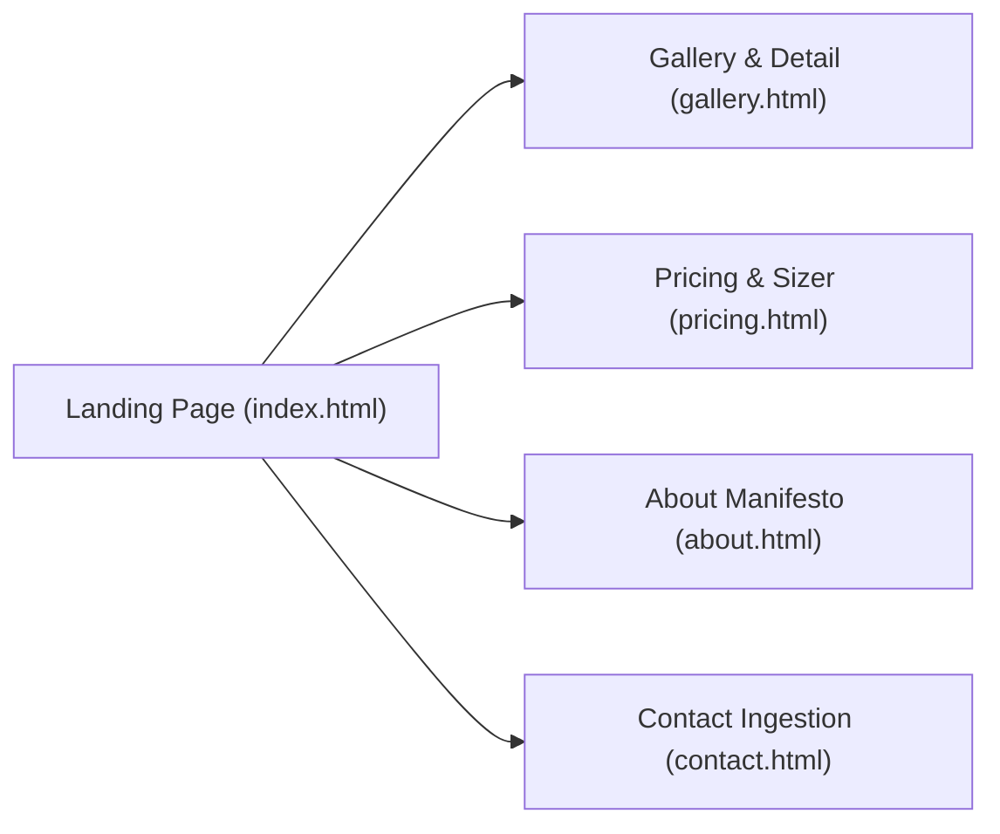

# BLUEPRINT & RANCANGAN REPLIKASI UI/UX: VAYRA STUDIO
## Analisis Dekonstruksi 1:1 dan Rencana Pembangunan Web Native Zero-Dependency

Dokumen ini adalah rancangan teknis untuk mereplikasi tampilan antarmuka (UI) dan pengalaman pengguna (UX) dari **https://vayra-preview.pages.dev/** secara identik (1:1), dengan aset gambar kurasi alternatif (*different curated images*), serta menggantikan seluruh ketergantungan library eksternal (GSAP, ScrollTrigger, Lenis) menggunakan **Standar Native Web Modern (HTML5, Modern CSS, ES2024+ Vanilla JS)**.

---

### 1. Karakteristik & Design System Vayra
- **Gaya Visual**: *Dark Obsidian & Studio Precision* (Brutalisme Minimalis Teknis).
- **Palet Warna**:
  - Background Utama: `#0A0A0B` (Hitam Obsidian Karbon pekat)
  - Background Kartu/Permukaan: `#141416` (Deep Charcoal bertingkat)
  - Teks Utama: `#F4F4F5` (Off-white / Titanium kontras tinggi)
  - Teks Redup/Sekunder: `#8A8A90` (Abu-abu semen/beton)
  - Border Hairline Presisi: `rgba(244, 244, 245, 0.12)` (Garis 1px sangat tipis)
  - Divider Lembut: `rgba(244, 244, 245, 0.06)`
- **Tipografi**:
  - Headings & Body: `"Plus Jakarta Sans", system-ui, sans-serif`
  - Metadata & Monospace (Seed, Model, Dimensi, Prompt): `"JetBrains Mono", ui-monospace, monospace`
  - Fluid Headline: `clamp(40px, 7vw, 96px)`
- **Geometri**:
  - Precision Radius: `4px` (`--vy-radius: 4px`), memberikan kesan instrumen audio studio profesional.
- **Micro-Interactions Khas**:
  - Micro-label di atas menu navigasi: `( Start ) HOME`, `( Output ) GALLERY`, `( Plans ) PRICING`, `( Studio ) ABOUT`, `( Say hi ) CONTACT`, `( Answers ) FAQ`.
  - Technical pill tags: `[ Photoreal ]`, `[ Product ]`, `[ Illustration ]`, `[ Upscale ]`, `[ Flux + SDXL ]`, `[ 4096 px ]`, `[ 12 presets ]`.

---

### 2. Dekonstruksi & Rencana Arsitektur 5 Halaman

#### A. Halaman 1: Landing Page (`index.html`)
1. **Header & Dual-Label Navigation**:
   - Logo `VAYRA` di kiri atas.
   - Menu desktop horisontal dengan micro-label di atas teks: `( Start ) HOME`, `( Output ) GALLERY`, dll.
   - Drawer mobile-first untuk layar HP (< 768px).
2. **Hero Section (`#hero`)**:
   - Headline raksasa editorial: *"Vayra — a text-to-image studio that keeps the seed, the settings and the license with every frame"*.
   - Slider frame interaktif dengan tombol panah `←` dan `→` untuk mengganti render yang ditampilkan beserta prompt dan metadata teknisnya.
3. **Problem Statement (`#problem`)**:
   - Blok teks editorial kontras tinggi: *"Most image tools stop at the first render..."*.
4. **Four Output Paths (`#vy-core-skills`)**:
   - 4 pilar kemampuan: Photoreal, Product, Illustration, Upscale.
5. **Showcase Gallery Grid (`#gallery`)**:
   - Grid 8 kartu render dengan filter kategori dan link menuju halaman log lengkap.
6. **Core Capabilities (`#capability`)**:
   - 3 kartu arsitektural: *The seed travels with the image*, *Batches not one-offs*, *Legal generation record*.
7. **24-Hour Throughput Metrics (`#metrics`)**:
   - Visualisasi grafik throughput batang sampled per 15 menit.
8. **Interactive Pricing Preview**:
   - 3 tier ringkas (Starter $0, Studio $24, Scale $96) + sizer kredit interaktif.
9. **FAQ Accordion (`#faq`)**:
   - 6 pertanyaan dengan ekspansi halus CSS grid `0fr` -> `1fr`.
10. **Conversion CTA Band & Footer**:
    - Banner penutup, tautan sosial, copyright, dan status produk.

#### B. Halaman 2: Gallery & Detail Viewer (`gallery.html`) — *Fitur Utama Permintaan User*
- **Leaf Banner Hero**: Judul *"Every frame we kept — The full render log: every frame with the model, seed and settings it was made with"*.
- **Filter Chips**: Filter dinamis (*All*, *Photoreal*, *Product*, *Illustration*, *Upscale*).
- **Master-Detail Split Layout (`.vy-leaf-band--halves.vy-out`)**:
  - **Master List Kiri (`#vy-log-list`)**: Susunan tombol kartu `.vy-reel-cell` interaktif (01, 02, 03...). Setiap sel memuat thumbnail, judul render, model tag (`vayra-photo-3`), dimensi (`2048 × 2560`), langkah (`34 steps`), dan nomor seed unik (`#884213097`).
  - **Detail Viewer Kanan (`<aside class="vy-out__viewer">`)**:
    - Pratinjau gambar resolusi tinggi dengan *aspect-ratio* dinamis (`--vy-out-ratio`).
    - Judul render dan badge kategori.
    - Data spesifikasi teknis (`<dl class="vy-idx">`): Model, Steps, Seed, Fork source, Dimensions, Full text prompt.
    - Tombol aksi **"Copy prompt"** dengan status feedback instan.
    - **Responsif Mobile (< 900px)**: Viewer berpindah ke bagian atas daftar atau mengambang mulus saat kartu diketuk tanpa me-reload halaman.

#### C. Halaman 3: Pricing & Volume Sizer (`pricing.html`)
- Leaf Hero: *"Pick a lane, change it later"*.
- 3 Kartu Paket: Starter ($0), Studio ($24), Scale ($96).
- **Interactive Credit Volume Sizer**: Slider rentang jumlah render per bulan dengan pengali resolusi (1024px, 2048px, 4096px) yang merekomendasikan paket optimal secara real-time.
- **Feature Comparison Matrix Table**: Tabel perbandingan teknis lengkap (Output, The record, License, API).
- Billing FAQ Accordion.

#### D. Halaman 4: About / Studio Manifesto (`about.html`)
- Leaf Hero: *"Why we keep the seed"*.
- Editorial Story: *"We build the part that remembers"*.
- 4 Prinsip Inti: *Reproducible by default*, *Batch first then pick*, *Grayscale on purpose*, *Readable output*.
- Batasan Engine: *"Things it will not do"*.

#### E. Halaman 5: Contact Desk (`contact.html`)
- Leaf Hero: *"Tell us what you need made"*.
- Interactive Form: Chips pemilih topik (*Licensing*, *Enterprise volume*, *Custom fine-tuning*, *General question*), kolom input dengan standar font 16px (anti-zoom iOS), dan honeypot anti-spam.
- Kartu Ekspektasi: *One inbox*, *Two working days*, *Bring the seed*.

---

### 3. Strategi Penggantian Library Eksternal Menjadi Web Native

| Fitur di Vayra Asli | Library Eksternal Asli | Solusi Pengganti Web Native (0 Dependency) |
| :--- | :--- | :--- |
| **Smooth Scrolling** | Lenis.js (18 KB) | CSS Native `html { scroll-behavior: smooth; }` & JS `window.scrollTo({ behavior: 'smooth' })`. |
| **Scroll Trigger Animations** | GSAP (73 KB) + ScrollTrigger (45 KB) | Native Web API `IntersectionObserver` & CSS Hardware-Accelerated transitions (`transform`, `opacity`). |
| **Page Transitions** | Custom JS overlay curtain | Native **View Transitions API** (`document.startViewTransition`) didukung browser modern. |
| **Accordion Animation** | GSAP back.out easing | Modern CSS Grid transition: `grid-template-rows: 0fr` ke `1fr`. |
| **Total Beban Skrip** | **~155 KB Pustaka Eksternal** | **~15 KB Vanilla JS Native Ringan (Hemat >90% Ukuran Transfer)**. |

---

### 4. Rencana Kurasi Citra Alternatif (Aesthetic Studio Imagery)

Sesuai instruksi *"namun dengan image yang berbeda!"*, aset gambar akan dikurasi menggunakan tema citra studio artistik berkualitas tinggi berlisensi bebas (*high-resolution studio renders*):
1. **Kategori Photoreal**: Potret editorial sinematik pencahayaan studio *softbox*, arsitektur minimalis modern monokromatis.
2. **Kategori Product**: Speaker silinder aluminium matte hitam, jam tangan mekanikal titanium mikro presisi.
3. **Kategori Illustration**: Lanskap monokromatik teknik tinta kuas (*Sumi-e*), gambar isometrik arsitektur garis bersih.
4. **Kategori Upscale**: Tekstur dinding beton brutalist 4K, serat tenun wol makro beresolusi tinggi.
